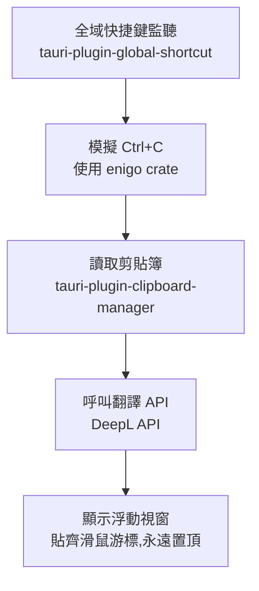

# Select-Translate 設計文件

## 專案目標

在 Windows 上,不論使用者在哪個應用程式裡選取文字(網頁瀏覽器、PDF 閱讀器、Word 等,不限單一 App),按下設定好的全域快捷鍵後,自動偵測選取內容、呼叫翻譯 API,並在滑鼠游標旁彈出一個浮動小視窗顯示翻譯結果。

## 技術棧

- **框架**:Tauri 2.x
- **後端語言**:Rust
- **前端**:純 HTML / CSS / JavaScript(刻意不使用 React、Vue 等框架)
- **套件管理**:npm
- **專案名稱**:select-translate
- **目標平台**:目前僅 Windows

## 核心架構

流程說明:

1. **全域快捷鍵監聽**——App 以背景常駐方式執行,不限焦點在哪個視窗都能偵測到快捷鍵
2. **模擬 Ctrl+C**——偵測到快捷鍵後,模擬複製動作,把使用者當下選取的文字複製進系統剪貼簿
3. **讀取剪貼簿**——取得剛複製到的文字內容;複製後剪貼簿不會立即更新,需要短暫延遲(約 50–150ms)才讀取,否則可能拿到舊內容
4. **呼叫翻譯 API**——把文字送給 DeepL API,取得翻譯結果
5. **顯示浮動視窗**——用 Tauri 的多視窗機制,開啟一個無邊框、永遠置頂的小視窗,定位在滑鼠游標附近顯示原文與譯文

## 已確定的設計決策

- **系統匣常駐 App**:不顯示一般主視窗,不佔工作列,啟動後只在系統匣留一個圖示,只有觸發翻譯時才跳出浮動小視窗
- **前端不使用框架**:純 JS,理由是後端已經要學 Rust,同時再學 TypeScript 或前端框架會分散心力;等專案完成、Rust 熟悉後再考慮升級
- **剪貼簿還原邏輯從第一版就納入**:模擬 Ctrl+C 會覆蓋使用者原本剪貼簿的內容,因此流程要在複製前先記住舊的剪貼簿內容,翻譯完後寫回去,避免悄悄覆蓋使用者原本複製的東西
- **翻譯 API 選擇 DeepL**:免費額度每月 50 萬字元、永久免費,且明確支援 `ZH-HANT`(繁體中文)作為目標語言,翻譯品質評價優於 Google
- **HTTP 請求在 Rust 端發送(reqwest)**:DeepL API 不接受瀏覽器端直接呼叫(沒有 CORS),所以必須由後端發請求;TLS 使用 Windows 內建的 schannel(`native-tls`),不需額外編譯 C 函式庫
- **API 金鑰存在使用者設定檔**:由設定視窗輸入,存於 `%APPDATA%\com.ivani.select-translate\settings.json`,不寫死在程式碼、不進版控

## 實作細節

### 程式結構

| 檔案 | 負責內容 |
| --- | --- |
| `src-tauri/src/lib.rs` | Tauri Builder、plugin 註冊、系統匣、翻譯流程、浮動視窗定位、`#[tauri::command]` 指令 |
| `src-tauri/src/settings.rs` | 設定(金鑰、快捷鍵)的讀取與儲存 |
| `src-tauri/src/selection.rs` | 保存剪貼簿 → 模擬 Ctrl+C → 讀取選取文字 → 還原剪貼簿 |
| `src-tauri/src/deepl.rs` | 呼叫 DeepL API 與錯誤訊息轉換 |
| `src/index.html`、`main.js`、`styles.css` | 設定視窗(視窗 label:`main`) |
| `src/popup.html`、`popup.js`、`popup.css` | 浮動翻譯視窗(視窗 label:`popup`) |

### 取得選取文字

- 快捷鍵在「放開」時才觸發,此時主按鍵已放開
- 送出 Ctrl+C 前,先按住 Ctrl,再放開快捷鍵中仍被按著的 Alt / Shift / Win。否則實際送出的會是 Ctrl+Alt+C 之類的組合(Ctrl+Shift+C 在瀏覽器會開啟開發者工具);在 Ctrl 按著時放開 Alt,也不會觸發應用程式的選單列
- 原剪貼簿是文字時先清空,才能分辨「真的複製到東西」與「讀到舊內容」;原剪貼簿不是文字(例如圖片)時不清空
- 讀取方式為每 50ms 檢查一次剪貼簿,最多等 0.5 秒,拿到內容就繼續,不使用固定延遲
- 讀到選取文字後立刻寫回原剪貼簿(不等翻譯完成),縮短剪貼簿被佔用的時間
- 同一時間只允許一個翻譯操作剪貼簿(`Mutex`);連續觸發時,只顯示最後一次的翻譯結果(`request_id`)

### 浮動視窗

- 預設出現在游標右下方,超出螢幕就翻到游標另一側,並限制在游標所在螢幕的工作區(不含工作列)內
- 前端排版完成後回報內容高度,後端依此調整視窗大小並重新定位;最高 420 邏輯像素,超過時在視窗內捲動
- 失去焦點、按 Esc 或按 ✕ 時隱藏

## 技術選型理由

- **為什麼是 Tauri,不是 Electron**:Tauri 使用系統原生 WebView(Windows 上是 WebView2),不用像 Electron 那樣打包整個 Chromium,安裝檔體積小很多(個位數~20MB,對比 Electron 常見 100MB+);這次也刻意選 Tauri 作為練習真正動手寫 Rust 的機會(先前只讀過 Rust,沒寫過)
- **為什麼是 DeepL,不是 Google 官方 API**:Google Cloud Translation API 沒有永久免費層、需要綁定帳單;DeepL 免費額度對個人日常使用更划算

## 已知的技術限制

- 模擬 Ctrl+C 對「支援複製貼上」的程式都有效,但少數受保護的 PDF 或防拷貝設計的內容會擋掉——這是這個方案本身的天花板,不是實作沒做好
- 剪貼簿還原只支援文字:原剪貼簿是圖片等非文字內容,且這次有選到文字時,複製動作會覆蓋原內容,無法還原
- 以系統管理員權限執行的程式,一般權限的 App 無法對其模擬按鍵(Windows UIPI 限制)
- 單次翻譯上限 5000 字,避免誤選整頁內容而耗光 DeepL 額度
- Rust 專案第一次編譯會比較慢(要把所有相依套件從原始碼編譯一次),屬正常現象

## 可能的 v2 方向(尚未決定要不要做)

參考開源專案 Pot(pot-desktop,同樣用 Tauri 開發的跨平台劃詞翻譯工具)的設計,未來可以考慮加入:

- **剪貼簿監聽模式**:被動監聽剪貼簿變化,不主動模擬按鍵,對會擋掉模擬複製的軟體更保險
- **截圖 OCR 翻譯**:針對完全無法選取文字的內容(圖片、掃描版 PDF),改用截圖 + OCR 辨識文字再翻譯

## 開發進度

- [x] Tauri + Vanilla JS 專案骨架
- [x] 全域快捷鍵設定(可在設定視窗修改)
- [x] 模擬 Ctrl+C + 讀取剪貼簿邏輯
- [x] 呼叫 DeepL API
- [x] 浮動視窗 UI 與定位邏輯
- [x] 系統匣常駐設定(隱藏主視窗)
- [x] 剪貼簿還原邏輯
